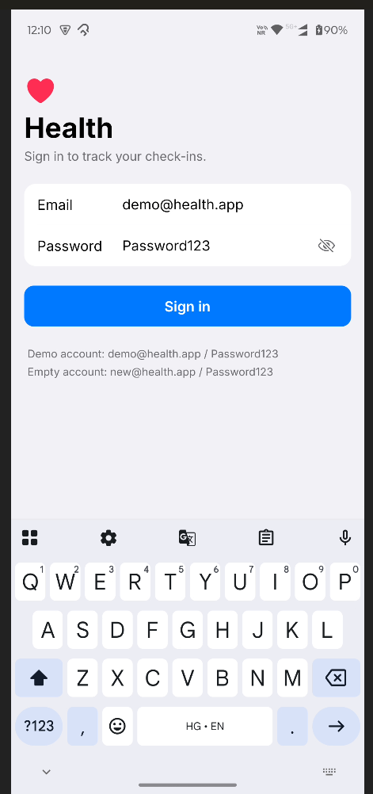
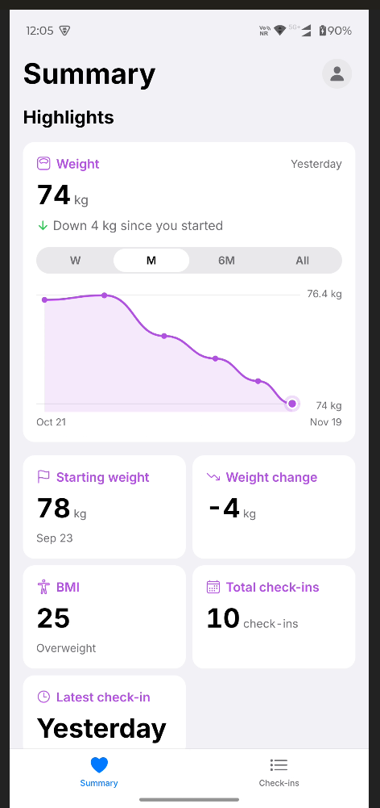
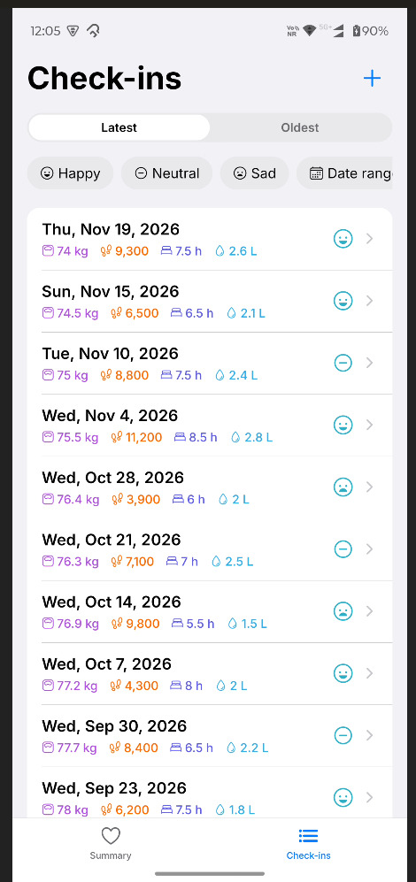
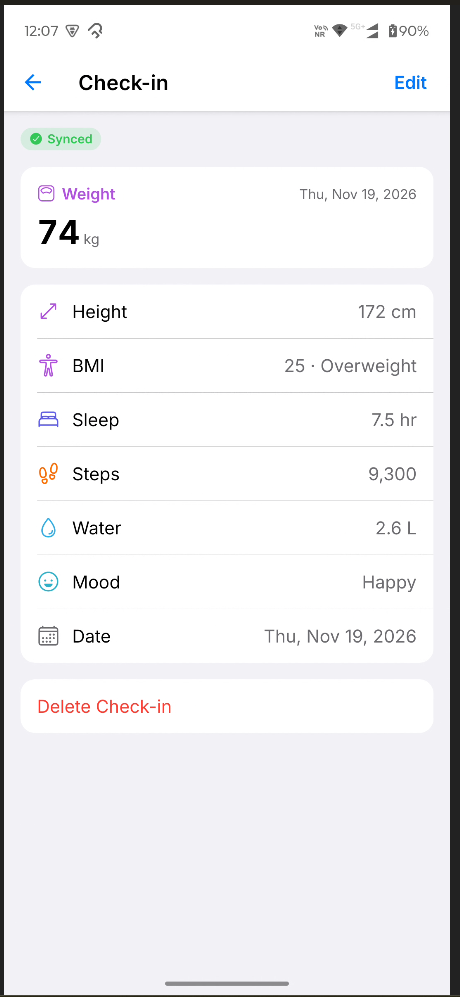
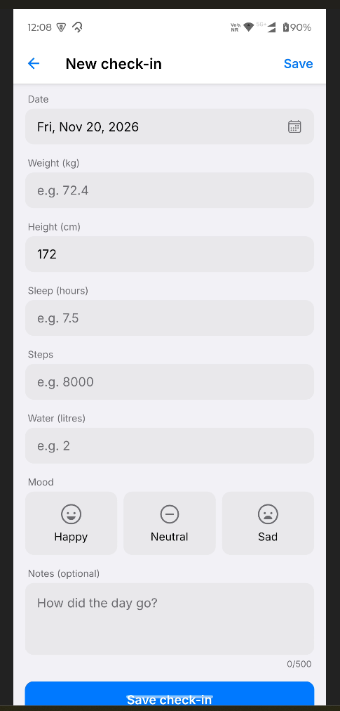

# Health Progress Tracker

A React Native (Expo, TypeScript) app for logging daily health check-ins (weight, height, sleep, steps, water, mood, notes) and watching progress over time. It has sign-in, a dashboard with a weight chart, full check-in CRUD with sorting and filtering, **offline support with a pending-sync outbox**, and a deep link (`healthtracker://checkin/:id`).

The visual design follows Apple Health (grouped background, shadowless cards, large titles, one colour per metric category, big numbers). Light and dark mode both work, because every colour comes from theme tokens.

The backend is a **mock REST server that runs inside the app** (own persisted database, latency, failures, offline errors). So the APK works with no server running.

### Screenshots

<table>
  <tr>
    <td align="center" valign="top" width="33%">
      <br>
      <b>Sign in</b><br><sub>Demo accounts listed on screen</sub>
    </td>
    <td align="center" valign="top" width="33%">
      <br>
      <b>Summary</b><br><sub>Weight chart (W / M / 6M / All), trend as arrow + text</sub>
    </td>
    <td align="center" valign="top" width="33%">
      <br>
      <b>Check-ins</b><br><sub>Latest / Oldest sort, mood and date filters</sub>
    </td>
  </tr>
  <tr>
    <td align="center" valign="top" width="33%">
      <br>
      <b>Check-in detail</b><br><sub>Deep-link target, shows sync status</sub>
    </td>
    <td align="center" valign="top" width="33%">
      <br>
      <b>New check-in</b><br><sub>Validated with zod, height pre-filled</sub>
    </td>
    <td width="33%"></td>
  </tr>
</table>

Demo video: _link_

---

## Setup & run

### Prerequisites

- Node.js LTS and npm
- Android Studio with the Android SDK, Platform-Tools and Build-Tools. `ANDROID_HOME` set, and `platform-tools` on `PATH`.
- A JDK. The one bundled with Android Studio works (set `JAVA_HOME` to its `jbr` folder).
- An Android phone with USB debugging on (`adb devices` must list it), or an emulator.

The app uses native modules (secure store, NetInfo, SVG, date picker) and a custom URL scheme, so it needs a **development build**. Expo Go will not work.

### Install and run

```sh
npm install

# First time: builds the native app and installs the dev client on the connected device (5-10 min)
npx expo run:android

# Afterwards, if the dev client is already installed, only Metro is needed
npx expo start --dev-client
```

> **Windows note:** the config plugin `plugins/withShortCmakeDir.js` moves the CMake build folder to `C:/hc`. Without it, native codegen paths pass the 248-character limit of the bundled ninja and the build fails. It does nothing on macOS or Linux. `android/` is generated by Expo and is git-ignored, so it is never edited by hand.

### Demo accounts

| Email | Password | Data |
|---|---|---|
| `demo@health.app` | `Password123` | 10 seeded check-ins over the last 58 days, weight falling from 78 to 74 kg, mixed moods |
| `new@health.app` | `Password123` | No check-ins. Use it to see the empty states. |

The mock server seeds itself on first launch. Clearing the app's data re-seeds it.

### Run the tests and checks

```sh
npm test              # Jest (jest-expo + Testing Library)
npm run typecheck     # tsc --noEmit
npm run lint          # expo lint
```

### Install the APK

```sh
# A release APK needs the native project (generated, git-ignored)
npx expo prebuild --platform android      # skip if android/ already exists
cd android && ./gradlew assembleRelease   # Windows: gradlew.bat assembleRelease
# -> android/app/build/outputs/apk/release/app-release.apk

adb install -r android/app/build/outputs/apk/release/app-release.apk
```

The release build is signed with the debug keystore, which is fine for sideloading. It needs no server, because the mock server is inside the app. Pre-built APK: _link_

### Simulating bad networks

There is no in-app developer menu. To test failures, edit the defaults of `devConfig` at the top of [src/api/mockServer.ts](src/api/mockServer.ts) and reload:

```ts
export const devConfig = {
  latencyMs: { min: 600, max: 1500 }, // every request waits this long
  failureRate: 0,                     // 0..1: chance a request fails with a 500
  forceOffline: false,                // pretend there is no connection
};
```

Real airplane mode also works, because the mock server and the app both read NetInfo.

---

## Architecture overview

Dependencies point one way: down. A layer only knows about the layer directly below it.

```
┌──────────────────────────────────────────────────────────────┐
│  src/app/        Expo Router routes (thin: render a screen)  │
│  src/screens/    Screens: layout and rendering only          │
│  src/components/ ui/ states/ checkins/ charts/               │
└───────────────┬──────────────────────────────────────────────┘
                │ call
┌───────────────▼──────────────────────────────────────────────┐
│  src/hooks/      useCheckins, useCheckin, useCreate/Update/  │
│                  DeleteCheckin, useDashboardStats,           │
│                  useNetworkSync, useDeepLinkHandler ...      │
└───────┬─────────────────────────────────┬────────────────────┘
        │ read / write                    │ call
┌───────▼────────────┐          ┌─────────▼────────────────────┐
│  src/stores/       │◄─────────│  src/services/               │
│  Zustand           │  writes  │  checkinRepository (online/  │
│  auth, checkins    │  results │  offline routing, retry)     │
│  (server cache),   │          │  syncService (triggers+lock) │
│  outbox, network,  │          │  networkMonitor              │
│  filter            │          └─────────┬────────────────────┘
└───────┬────────────┘                    │ call
        │ persist                ┌────────▼─────────────────────┐
        │                        │  src/api/                    │
        │                        │  authApi, checkinsApi        │
        │                        │  └─► mockServer (fake remote │
        │                        │      DB, latency, failures)  │
        │                        └────────┬─────────────────────┘
┌───────▼────────────────────────────────▼─────────────────────┐
│  src/storage/    typed AsyncStorage wrapper, SecureStore     │
│                  (token), namespaced keys                    │
└──────────────────────────────────────────────────────────────┘

  src/domain/   pure functions (health, validation, filters, sync, deepLink, chart, cache)
                with no React, no I/O. Everything above calls into it. All unit tested.
  src/types/ src/utils/ src/theme/   shared by every layer
```

**Layering rules**

1. Components never call an API or storage. Screens call hooks.
2. Hooks never talk to the API directly. They call the repository or a store.
3. Business logic (BMI, dashboard stats, filters, validation, the sync engine, deep-link parsing) is in `src/domain/` as pure functions. Components only render.
4. `src/api/` is the only place that knows the "server" exists. Swapping `mockServer` for `fetch` calls changes two files and nothing else.

### Project structure

```
src/
  app/            Expo Router routes only. _layout (fonts, auth, network, deep links, Stack.Protected),
                  login, (tabs)/index (Summary), (tabs)/checkins, checkin/new,
                  checkin/[id]/index (deep-link target), checkin/[id]/edit, +not-found
  screens/        LoginScreen, SummaryScreen, CheckinListScreen, CheckinDetailScreen,
                  CheckinFormScreen (create + edit), NotFoundScreen
  components/
    ui/           Text, Card, Button, TextField, DateField, SegmentedControl, Chip, Badge, ListRow, ...
    states/       LoadingState, ErrorState, ErrorBanner, EmptyState, OfflineBanner, SyncNotice, CrashScreen
    checkins/     CheckinRow (memoised), SyncBadge, MoodPicker, MetricTile, SummaryTiles, WeightCard, filter bar
    charts/       WeightChart (custom, react-native-svg)
  hooks/          data hooks, useSubmitLock, useNetworkSync, useDeepLinkHandler, useIsMounted, ...
  stores/         authStore, checkinsStore, outboxStore, networkStore, filterStore
  services/       checkinRepository, syncService, networkMonitor
  api/            mockServer, mockDb (seed data), authApi, checkinsApi
  storage/        storage (AsyncStorage wrapper), secureStorage, keys
  domain/         health, validation (zod), filters, sync, deepLink, chart, cache, network, checkinForm
  theme/          colors, typography, spacing, useTheme
  types/          checkin, auth, api, sync, ui
  utils/          errors, retry, format, routes, logger
```

Test files sit next to the code they test (`*.test.ts`). None are inside `src/app/`, because Expo Router would treat them as routes.

---

## Key technical decisions and trade-offs

| Decision | Why | Trade-off |
|---|---|---|
| **Expo dev build, real Android phone** | Faster than an emulator. Airplane mode gives real offline testing. A custom `healthtracker://` scheme needs a dev build, because Expo Go only handles `exp://`. | A first native build takes 5-10 minutes. |
| **All native dependencies installed up front** | Each new native package forces a rebuild. One build early finds toolchain problems early. | None worth noting. |
| **Mock server inside the app, not json-server** | The APK works for reviewers with no server running. It has adjustable latency and failure rate, and it reads NetInfo, so airplane mode really breaks it. It keeps its own storage key, separate from the client cache, so it behaves like a remote database. | It is not a real network, so TLS, auth expiry and multi-device behaviour are not exercised. |
| **Custom data hooks, no React Query** | Loading, error, retry, caching and request de-duplication are all written in the repo and visible. Nothing is hidden in a library. | About 40 lines of retry and in-flight de-dupe to write and test, and no devtools. |
| **Zustand for app state, with `persist`** | One small, consistent tool. Persisting `checkinsStore` *is* the offline-read feature. Selectors keep re-renders low, and stores are testable outside React with `getState()`. | Less structure than Redux. Discipline (selectors, actions in the store) has to come from the code, not the library. |
| **Server cache and outbox in separate stores** | Server data and local-only pending data have different lifecycles and owners. The hook merges them with `useMemo`. | One merge step on every read (cheap, and tested). |
| **Explicit outbox + pure sync engine** | "Pending / Synced / Failed" is real data: it shows in the UI and is unit tested. | Only creates go through the outbox (see limitations). |
| **`clientId` idempotency key** | If a sync request reaches the server but the response is lost, the retry does not create a duplicate, because the server dedupes on `clientId`. | The server has to support it (the mock does). |
| **Dashboard = `computeDashboardStats(checkins)`** | Derived and memoised, never stored. It updates on create, edit, delete and sync because it reads the same merged list as the list screen. | Recomputed when the list changes (tens of items, so negligible). |
| **Expo Router (file-based)** | Built on React Navigation. Every route is also a URL, so `healthtracker://checkin/123` maps to `src/app/checkin/[id]/index.tsx` on cold and warm start with no linking config. `Stack.Protected` gives declarative auth gating. | Auth-gated deep links need a small extra step (the pending link below). |
| **Token in SecureStore, data in AsyncStorage** | The token is a secret and belongs in the platform keystore. Check-ins are bulky, non-secret and need fast bulk reads. | Two storage APIs to know. |
| **Apple Health visual language** | A restrained, recognisable system. Category colours and tokens give dark mode almost for free. | Deliberately not a branded design. |

---

## State management

### Why Zustand + custom hooks (not Redux Toolkit or React Query)

- **Redux Toolkit** would add slices, a store provider and boilerplate for five small stores. Zustand does the same job with direct actions, selectors, and `persist` middleware, and stores can be read from non-React code (the sync service) with `getState()`.
- **React Query** would give caching, dedupe and retries for free, but it solves the *online* problem. This app's hard part is the offline outbox: merging local pending items, idempotent sync, and the status lifecycle. Those need explicit state either way, so the library would add a second model without removing the hand-written part. A small custom fetch layer keeps one mental model, with every caching and retry rule visible in the code.

### What lives where

| Kind of state | Where | Persisted |
|---|---|---|
| **Server cache**: check-ins as last fetched, plus fetch status, error, `lastFetchedAt`, `ownerUserId` | `checkinsStore` | items, `lastFetchedAt`, `ownerUserId` (AsyncStorage `ht:checkins-cache`) |
| **Outbox**: check-ins made on this device that the server has not accepted | `outboxStore` | items (AsyncStorage `ht:outbox`) |
| **Session**: user, token status, pending deep link | `authStore` | token in SecureStore, user in AsyncStorage |
| **Connectivity**: `isOnline` | `networkStore` (fed by NetInfo) | no |
| **List filters** (sort, moods, date range) | `filterStore`, so they survive navigating to a detail and back | no |
| **UI state**: form fields, pickers, modals, chart range | local `useState` / react-hook-form inside the screen | no |

Derived data (dashboard stats, the filtered list, the merged server + outbox list) is computed with `useMemo` and never stored. A stored copy can disagree with its source; a computed one cannot.

### How a change reaches the dashboard and the list

There is one source of truth. `useCheckins()` returns `mergeWithOutbox(outbox.items, checkinsStore.items)`. The list screen filters it, and `useDashboardStats()` runs `computeDashboardStats` on it. So creating, editing or deleting a check-in just writes to a store (`upsert`, `removeLocal`, or the outbox), and every screen that reads the merged list re-renders. There is no event bus, no manual refresh, and no second copy to keep in step. Pending items count in the dashboard like any other.

### Data-hook contract

Every data hook returns the same shape, so screens treat them alike:

```ts
// queries (useCheckins, useCheckin)
{ data, status, error, isRefreshing, refetch }     // + isOffline

// mutations (useCreateCheckin, useUpdateCheckin, useDeleteCheckin)
{ mutate, isSubmitting, error, reset }
```

### Loading, error and retry

- Every async screen handles **loading, error (with a Retry button), empty and data**. The list and the dashboard also distinguish "no check-ins yet" from "none match your filters".
- The first load shows a full-screen loader. A refetch while data exists sets `isRefreshing` and keeps the old data on screen (no spinner takeover). A failed refresh keeps the old data and shows a small inline error instead of an error screen.
- Screens wait for the persisted cache to be read from disk (`hasHydrated`) before deciding the list is empty, so there is no false "No check-ins yet" flash on launch.
- `withRetry(fn, { retries, baseDelayMs })` in [src/utils/retry.ts](src/utils/retry.ts) retries with exponential backoff (500 ms, 1 s, ...). It retries network errors and 5xx only, never 404 or other 4xx. The repository uses it for **reads only**; see the sync section for why writes are not auto-retried.
- Errors shown to the user are plain messages, and Android announces them (`accessibilityLiveRegion="polite"`).

### In-flight request de-duplication

`checkinsStore.fetchAll(userId)` keeps one module-level `inFlight` promise. If Summary and the list both mount and ask at the same moment, the second caller gets the first caller's promise, so **one** request goes out. `fetchAll` also never throws: failures land in `status` and `error`.

Stale results are discarded:

- **Logout or user switch mid-fetch:** the response is dropped if `ownerUserId` no longer matches.
- **Local change mid-fetch:** a `localVersion` counter is bumped by every `upsert` / `removeLocal` / `reset`. If it moved while a request ran, the response might predate that change, so the store asks once more instead of overwriting it.
- **Unmount:** `useCheckin` numbers its requests and ignores any that are superseded or arrive after unmount. `useIsMounted` guards state updates in the mutation hooks.
- **Freshness:** data younger than 30 s is not refetched on screen mount, so moving between tabs does not spin.

### Duplicate-submit guard

`useSubmitLock` uses a `useRef` lock (flips synchronously, so two taps in the same frame cannot both pass) plus an `isSubmitting` state (so the UI can show a spinner and disable the button). State alone is too slow for a fast double tap. The idempotent `clientId` is the backstop on the server side.

### Avoiding unnecessary re-renders

- Components subscribe with selectors (`useStore(s => s.x)`). Multi-field reads use `useShallow`. Nothing subscribes to a whole store.
- `CheckinRow` is wrapped in `React.memo`, and the list's `renderItem` and `onPress` handlers are stable (`useCallback`), so one row changing does not re-render the rest. The list is a `FlatList` with a `keyExtractor`.
- Derived lists and stats are `useMemo`'d against their real inputs.
- `useCheckins` reads freshness with `getState()` inside the effect rather than subscribing to it, so a finished fetch does not re-trigger the effect that started it.

---

## Offline storage and synchronization

### The pieces

| Piece | Responsibility |
|---|---|
| `checkinsStore` (persisted) | The last server copy. It is why the list and dashboard still work after you kill the app in airplane mode. |
| `outboxStore` (persisted) | Check-ins created on this device and not yet accepted by the server. Survives restarts. |
| `networkStore` + `networkMonitor` | `isOnline`, fed by NetInfo. `isConnected === false` or `isInternetReachable === false` counts as offline. `null` ("unknown yet") does not. |
| `checkinRepository` | Decides online or offline for each operation. |
| `domain/sync.ts` | The pure sync engine: `syncOutbox`, `mergeWithOutbox`, `backoffDelayMs`. No stores, no clock, no network. |
| `syncService.runSync` | Runs the engine against the real stores, with a lock. |
| `useNetworkSync` | Decides *when* to run it. |

### Reading offline

`checkinsStore` is saved to AsyncStorage (`persist`, version 1, `partialize` to `items`, `lastFetchedAt`, `ownerUserId`). On launch it is read back before screens decide anything. Offline, `useCheckins` does not fetch: the saved copy is the answer, and an offline banner is shown. A failed request while cached data exists is treated as "offline", not as an error screen. A cache that is missing, corrupt or in an unknown shape is treated as no cache, never as a crash. A saved copy owned by a different user is never shown.

`useCheckin(id)` shows a cached copy immediately (no spinner) and refreshes in the background when online. A check-in that only exists on the device (`local_...`) is never requested from the server.

### Creating offline

`checkinRepository.create` generates a `clientId` (a UUID from `expo-crypto`) and then:

- **Offline:** builds a pending check-in (`id: "local_<clientId>"`, `syncStatus: 'pending'`) and adds it to the outbox.
- **Online:** calls the API with the `clientId`. If the request fails with a **network error** it falls back to the outbox, with the *same* `clientId`, because the request may or may not have reached the server. Any other failure (the server said no) is thrown, and the form shows it and keeps the user's input.

Editing or deleting a **pending** item changes only the outbox. Editing or deleting a **synced** item offline is blocked with "You're offline. Reconnect to edit synced check-ins." (see limitations). Editing a *failed* item puts it back to `pending` with its error and backoff cleared, so it retries right away.

### Merge and de-duplication

Every screen reads `mergeWithOutbox(outbox, server)`: pending items first, then the server's. If the server already has an outbox item (same `clientId`) the server copy wins and the outbox copy is dropped. This is what stops a check-in appearing twice during the moment a sync finishes.

### Sync triggers

`useNetworkSync` is mounted once in the root layout and does nothing while signed out.

| Trigger | Mode |
|---|---|
| Login, or app start with a saved session | forced (ignore any old backoff) |
| Connection comes back (offline to online) | forced (a backoff set while offline means nothing now) |
| App returns to the foreground | normal (items still in backoff are left alone) |
| Tap **Retry** on a failed item | forced |

### The lock

`runSync` allows one run at a time. A second caller while a run is going gets the **same promise**, not a second run. The one exception is a *forced* request during a *normal* run: the normal run may have skipped that item because of its backoff, so the forced run is queued right after it. Before sending, `runSync` asks NetInfo directly (`refreshNetworkStatus`) rather than trusting the store, because at app start the store can say "online" for a moment, which would mark every pending item as failed just because the phone is offline. It also waits for the outbox to finish loading from disk.

While a run is sending, editing a pending item is blocked, because the edit would be lost when that item is removed from the outbox.

### What one run does

1. Take the items that are due: `nextRetryAt` is empty or in the past, or all of them if forced.
2. Send them **one at a time, oldest `checkinDate` first**, so the server receives them in the order they happened. One failure never stops the rest.
3. For each success, remember `{ clientId, serverCheckin }`. For each failure, record the message, `attempts + 1` and `nextRetryAt`.
4. Apply the results in one synchronous step: `upsertMany` the server copies into `checkinsStore`, then remove the same items from the outbox, then mark failures. There is no `await` between the insert and the removal, so a row never flickers or doubles.
5. Show "Synced N check-ins" for a few seconds, then quietly refetch the list.
6. If the user signed out mid-run, drop the results.

### Idempotency

The server's `createCheckin` looks up `clientId` first and returns the existing record if it has one. So if a request is accepted but the response is lost (a timeout, the app is killed), the item stays in the outbox, is sent again later with the same `clientId`, and the server returns the record it already made. No duplicate. This is also why writes are not wrapped in `withRetry`: the outbox plus `clientId` is the retry mechanism for creates.

### Backoff

After the n-th failure the next attempt waits `min(2^n x 2 s, 60 s)`: 4 s, 8 s, 16 s, 32 s, then 60 s. Backoff is checked when a trigger fires (reconnect, foreground, login, Retry), not on a timer, which keeps the engine pure and testable.

### Status lifecycle

```
                 create offline, or online request never arrived
                                   │
                                   ▼
                            ┌─────────────┐
              edit / ──────►│   PENDING   │◄────────────────────────┐
            (resets error)  └──────┬──────┘                         │
                                   │ sync run sends it              │
                      ┌────────────┴────────────┐                   │
                      │ server accepts          │ request fails     │
                      ▼                         ▼                   │
               ┌─────────────┐          ┌─────────────┐             │
               │   SYNCED    │          │   FAILED    │─────────────┘
               │ (removed    │          │ error shown │  Retry / next trigger
               │ from outbox,│          │ attempts+1, │  once backoff has passed,
               │ new ck_ id) │          │ nextRetryAt │  or the item is edited
               └─────────────┘          └─────────────┘
```

In the UI (always an icon plus text, never colour alone): pending is an orange clock with "Pending sync"; failed is a red "Sync failed" with a tappable **Retry**; synced shows nothing in the list and a small green "Synced" check on the detail screen. A detail screen that was open on a `local_` id follows the item to its new server id by `clientId` when it syncs, instead of showing "not found".

### Logout

Logging out clears the token, resets `checkinsStore`, `outboxStore` and `filterStore`, and deletes the persisted keys of the first two. The outbox is not tied to a user, so without this a pending item would be sent to the next account that signs in.

---

## Deep linking

The app registers the scheme `healthtracker` (`app.json`). The link `healthtracker://checkin/<id>` opens that check-in's detail screen.

| Situation | What happens |
|---|---|
| Signed in, app running (warm) | Opens the detail. Back goes to the Check-ins/Summary tabs. |
| Signed in, app closed (cold) | Starts straight on the detail, with the tabs underneath so Back stays in the app. |
| Signed out (warm or cold) | Shows Login with "Sign in to open the shared check-in". After login the detail opens, with the tabs under it. |
| Check-in does not exist | "Check-in not found" with a "Go to Check-ins" button. |
| Check-in only exists on this phone (`local_...` id, not synced yet) | Opens from the outbox, with a "Pending sync" badge. |
| Any other path (`healthtracker://banana`) | "Page not found" with a button back home. |

**How it works.** Expo Router maps the URL to `src/app/checkin/[id]/index.tsx` itself, on cold and warm start, because the file path is the URL. Two things are ours:

- **Auth gating.** `Stack.Protected` hides the detail route while signed out, which would lose the link. `useDeepLinkHandler` (mounted in the root layout) reads `Linking.useURL()`; if the user is signed out it saves the id in `authStore.pendingDeepLink`, and once signed in it `push`es the detail exactly once and clears it. A logout drops a link that was never opened.
- **Back behaviour.** `unstable_settings = { anchor: '(tabs)' }` in the root layout keeps the tabs under a deep-linked detail. (`anchor` is the current name for what older docs call `initialRouteName`.)

`src/domain/deepLink.ts` is the pure parser. It accepts a trailing slash, a query string and a fragment. It returns `null` for other schemes, other paths, a missing id, extra segments, `checkin/new` (a real route, not an id), ids with unexpected characters, malformed `%` escapes and garbage, and it never throws.

### Testing with adb

```sh
# Use your applicationId from app.json (android.package)
PKG=com.ashutosh.healthtracker

# Warm start (app open): use a real id from the Check-ins list
adb shell am start -W -a android.intent.action.VIEW -d "healthtracker://checkin/ck_seed_3" $PKG

# Cold start: kill the app first, then open the link
adb shell am force-stop $PKG
adb shell am start -W -a android.intent.action.VIEW -d "healthtracker://checkin/ck_seed_3" $PKG

# Signed out: sign out in the app, force-stop, run the link, then sign in. The detail should open.

# A check-in that does not exist -> "Check-in not found"
adb shell am start -W -a android.intent.action.VIEW -d "healthtracker://checkin/doesnotexist" $PKG

# An unknown path -> "Page not found"
adb shell am start -W -a android.intent.action.VIEW -d "healthtracker://banana" $PKG

# Accepted variants: trailing slash and query string
adb shell am start -W -a android.intent.action.VIEW -d "healthtracker://checkin/ck_seed_3/?source=email" $PKG
```

- Quote the URL, because `&` and `?` mean something to the shell.
- On the dev client, the launcher can swallow a cold-start URL. Check cold start again on a release build: `npx expo run:android --variant release`.
- The seeded demo account has ids `ck_seed_1`, `ck_seed_2`, and so on. A check-in you create gets a new `ck_...` id from the server once it has synced.

---

## Testing

Run with `npm test`. The suite is mostly logic and hook tests, with a smaller set of screen tests, because the logic is where the bugs that matter live. About 50 suites and 600 tests.

| Area | What is covered | Why |
|---|---|---|
| **Domain** (`src/domain`) | BMI and categories (70 kg / 175 cm gives 22.9, Normal), dashboard stats (empty, single, unsorted, same-day input), zod validation boundaries (negative steps, sleep 30, water 0, future dates, `'abc'`, empty strings), filters and sort, chart range and scaling, cache freshness, network snapshot, deep-link parsing | Pure functions, cheap to test thoroughly, and everything else depends on them. |
| **Sync engine** (`sync.test.ts`) | All succeed, partial failure, all fail, backoff skip and force, oldest-first ordering, an idempotent retry (the server accepted but the response was lost), empty outbox, outbox merge and de-dupe | The highest-risk logic: data loss and duplicates. |
| **Stores** | In-flight de-dupe, stale-result discard on logout, persist and rehydrate (including a corrupt cache), outbox transitions, auth hydrate and logout cleanup, filter range rules | This is where the state rules live. |
| **Services** | Repository online/offline routing, network-error fallback to the outbox, sync lock and forced-after-normal queueing, an end-to-end offline flow (create offline, reconnect, synced, no duplicate) | Verifies the layers work together. |
| **Hooks** | Data-hook contract, refresh versus first load, offline fallbacks, `useSubmitLock` double-tap, mutation error handling, optimistic delete rollback, sync triggers, unmount safety | Behaviour screens rely on. |
| **Utils and API** | `withRetry` with fake timers (which errors retry, backoff timing), mock server endpoints, idempotent create, auth scoping, storage wrapper | |
| **Screens and components** | Login, list (loading, error, empty, filtered-empty, data), detail, form validation, dashboard, offline variants, `SyncBadge`, `Button`, `CrashScreen`, not-found | Loading, error, empty and data states of the async screens, online and offline. |

> **Known issue:** the router-level deep-link suite (`src/hooks/useDeepLinkHandler.router.test.tsx`) currently fails in Jest with `Cannot find native module 'ExpoLinking'`: the native module is not mocked in the test setup. The same behaviour is covered by the `parseDeepLink` unit tests and verified on a device with the adb commands above. Mocking `expo-linking` in `jest.setup.ts` is the fix.

---

## Assumptions and limitations

- **The "server" is on the device.** `mockServer` persists its own database in AsyncStorage. That makes the APK self-contained, but it also means the demo is single-device: two phones would each have their own server. Auth is simulated too (a plain-text password and a token that is just a user id) and is not secure by design.
- **Offline edits and deletes of synced check-ins are blocked.** Only *creates* (and edits or deletes of still-pending items) work offline. Supporting the rest needs an operation queue (create / update / delete) and rules for combining them, so the app shows a clear message instead.
- **No conflict resolution.** The server applies updates as **last write wins**, with no version or `updatedAt` check. A change made on another device between a fetch and a save is overwritten. With a single device this does not come up.
- **Backoff is evaluated on triggers, not on a timer.** A failed item retries when the connection returns, the app comes to the foreground, the user signs in, or the user taps Retry. There is no background task, so nothing syncs while the app is closed.
- **A 5xx on an online create goes to the form, not the outbox.** Only "the request never completed" (network error) falls back to the outbox, so the user sees real server rejections immediately. (A failure during a later *sync* does mark the item failed and retries it with backoff.)
- **Pagination is not implemented.** The list fetches everything, which is fine for the data sizes here.
- **Android only has been tested.** The code is cross-platform, but I built and tested on an Android phone.
- **Time zones:** check-in dates are calendar days (`yyyy-MM-dd`) in the device's local time.

---

## What I'd improve with more time

1. **Offline edit and delete** through a general operation queue, with coalescing (an edit of a pending create is folded into the create), instead of blocking them.
2. **Conflict handling:** version or `updatedAt` on records, `If-Match`-style updates, and a "changed elsewhere" resolution screen.
3. **A real backend** (and token refresh, TLS, hashed passwords). `src/api/` is the only layer that would change.
4. **Background sync** with `expo-background-task`, and a timer-based retry for items whose backoff has elapsed while the app is open.
5. **Pagination** (`cursor` and `limit` in the API and `loadMore` in the store) for long histories.
6. **A developer menu** (long-press the avatar) to toggle `forceOffline`, `failureRate` and latency without editing source.
7. **Crash and error reporting.** `logger.error` is the single hook point; wire it to Sentry.
8. **More tests at the screen level** with end-to-end flows (Maestro or Detox), and CI running typecheck, lint and tests on every push.
9. **Polish:** list animations, localisation, a metric toggle for imperial units, and iOS verification.

---

## AI tools used

- **Claude (chat), for planning.** Used to work through scope, architecture options and trade-offs. The outcome is in `CLAUDE.md` (project conventions: layering, tech stack, the data-hook contract, design tokens) and `PLAN.md` (the phased build plan). The decisions in the table above were settled there, before any feature code was written.
- **Claude Code (VS Code), for implementation.** The app was built phase by phase against `PLAN.md`, with Claude Code writing most of the code and tests inside the constraints set in `CLAUDE.md`. Each phase was checked on a physical Android phone against that phase's acceptance checks before it was committed, so the git history follows the phases.
- **Tooling and environment.** Also used for the Windows native build issue (the CMake path plugin) and for checking Expo SDK 58 APIs against the versioned docs.
